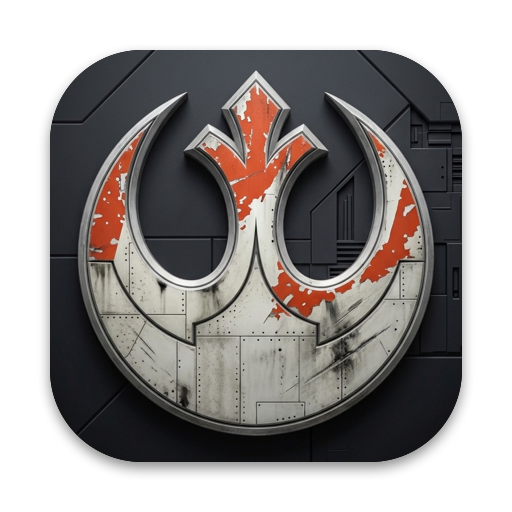

<p align="center">
  
</p>

# Red Two (macOS Apple Silicon / Metal Port)

A native **macOS (Apple Silicon / Metal)** port of **Red Two**, a static recompilation of **Star Wars: Rogue Squadron II – Rogue Leader** (GameCube), forked from [gminustwo/red_two](https://github.com/gminustwo/red_two) with additional quality-of-life enhancements.

The game's PowerPC code is translated to C++ ahead of time and runs natively on Apple Silicon via Metal (Aurora) and SDL3. **No game data or texture packs are included**: you need your own disc image of the USA release (`GSWE64`, revision 0), for both the `.app` download and your own build.

## Quick Start

1. Download `Red_Two_macOS_arm64.zip` from the [Releases](../../releases) page and unzip `Red Two.app`.
2. **First launch (macOS Gatekeeper)**: because the app is ad-hoc signed and not notarized by Apple, macOS will block it on first launch (or say it is "damaged"). Clear the quarantine flag once in Terminal:
   ```bash
   xattr -cr "/path/to/Red Two.app"
   ```
   *(Alternatively, try opening it once, then go to **System Settings → Privacy & Security** and click **Open Anyway**.)*
3. Open `Red Two.app` and select your own USA disc image (`GSWE64` `.rvz`, `.iso`, `.gcm`, or `.wia`) in the launcher — Red Two remembers its path.
4. Optional: copy a Dolphin HD texture pack (`GSWE64` folder) into `~/Library/Application Support/Red Two/textures/` or pick its folder under **F1 → MODS → Texture pack folder**.

## Features & macOS Enhancements

- **Native Apple Silicon (ARM64) & Metal** backend via Aurora + SDL3, including Aurora shader logic-op fallback (`patches/aurora/0034-logic-op-fallback.patch`).
- **Standalone macOS `.app` bundle** with bundled dylibs, custom icon, and macOS Fullscreen Spaces support.
- **Fullscreen Video Player** (*Making Of* & *Teaser*): fixed high-FPS (90/120/144 Hz) playback speed, 4:3 aspect lock, ±5s seeking (`Left`/`Right`), auto-hiding progress bar, and pause function.
- **Audio Commentary Controls**: press **L3** or **C** to pause/resume active commentary streams with automatic BGM/SFX ducking restoration and a subtle bottom-center HUD indicator.
- **Art Gallery Captions**: bottom-center title and slide counter overlay for all 27 concept art pieces and renders.
- **Nintendo Switch Pro Controller** auto-detection & button prompts (`SWITCH`), plus a generic Right Analog Stick icon replacing the baked GameCube C-stick in *Select Craft*.
- **Streamlined Menu**: *Special Features*, *Rogue Leaders*, *Passcodes*, *Options*, and **Quit** directly accessible from the Main Menu.
- **Cutscene Skip**: hold B to skip cutscenes.
- **Live V-Sync Toggle** in the Display menu.
- **All upstream Red Two features**: high internal resolutions (up to 4K), 4x MSAA, 16x anisotropic filtering, widescreen, MusyX audio DSP emulation, save states, Dolphin HD texture packs, Gecko/AR codes, cheats, passcode unlocks, and RetroAchievements (softcore).

## Controls & Files

- **In-game menu**: press **F1** or **Back / Select / Minus** on your controller.
- **Fullscreen**: toggle with **F11** or **Alt+Enter** (or in the Display menu).
- **Save states**: **Back + RB** saves, **Back + LB** loads, **Back + D-pad Left/Right** switches slots (keyboard: **F5 / F8 / F6 / F7**).
- **User files**: settings, memory card (`saves/GSWE64_A.raw`), save states, logs, shader cache, and texture packs live in `~/Library/Application Support/Red Two/`.

## Building on macOS (Apple Silicon)

Requirements: Xcode Command Line Tools (`clang`), Homebrew (`cmake`, `ninja`, `sdl3`, `libpng`, `freetype`, `zstd`, `xxhash`, `fmt`, `abseil`).

```bash
# 1. Build: recompiles the game straight from your disc image (RVZ, WIA, ISO or GCM)
tools/build_macos.sh --disc "<your Rogue Leader.rvz>"

# 2. Run
build/macos/red_two --disc "<your Rogue Leader.rvz>"
```

## Credits

Based on [gminustwo/red_two](https://github.com/gminustwo/red_two) and [Aurora](https://github.com/dolphin-emu/aurora). See the upstream repository for technical details on the static recompilation architecture and Windows/Linux builds.

The macOS port and quality-of-life enhancements in this fork were developed with the assistance of Google Gemini.

## Legal

Red Two is released under the [MIT License](LICENSE). It covers this repository's own code
only, not the game's code that a build (and the prebuilt downloads) contain in recompiled form.

This repository contains no code or assets from the game. Star Wars and Rogue Leader are
trademarks of Lucasfilm Ltd.; GameCube is a trademark of Nintendo. This project is not
affiliated with or endorsed by them.
